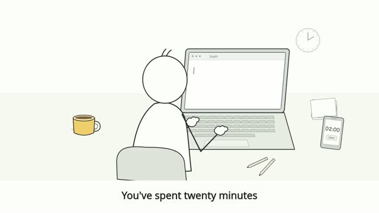
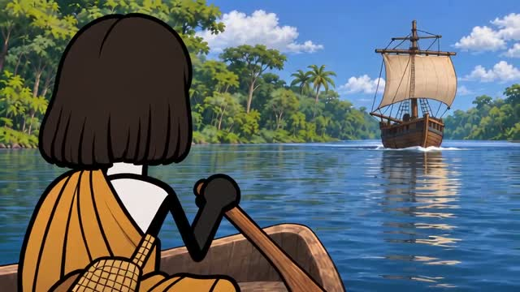
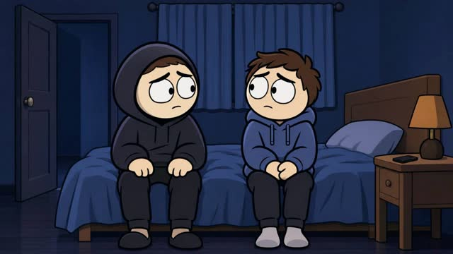
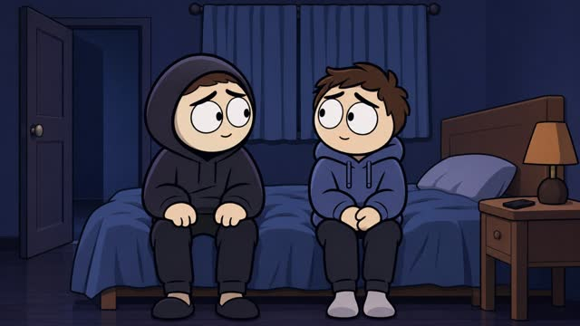
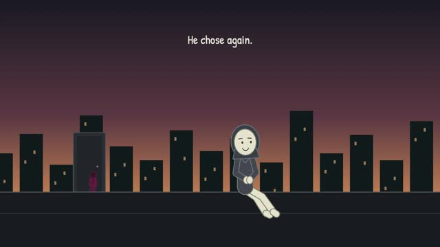

# Watch the editing styles

Each poster links to the actual reference video. These are the reviewed outputs, not promotional mockups.

For an offline player, clone or download the repository, then open **gallery.html** in your browser. Every standalone skill also includes its own player at **assets/reference/index.html**. No server or API key is needed to watch.

## B1 Minimal Stickman

Clean paper backgrounds, slim characters, clear desk staging and object inserts.

**30 seconds · Fola narration**

[Watch / download MP4](skills/studio-b1-minimal/assets/reference/preview.mp4) · [Open skill folder](skills/studio-b1-minimal/README.md)

Approved revised example; the portable drawing module is supplied separately.

## A5 Historical Cartoon

Period costumes, painterly environments and narrated historical storytelling.

**60 seconds · Fola narration**

[Watch / download MP4](skills/studio-a5-history/assets/reference/preview.mp4) · [Open skill folder](skills/studio-a5-history/README.md)

Historical visual reference generated with the now-retired Mini model. Future production uses the current workflow; this is not a newly validated Wan result.

## Expressive Cartoon — Hybrid

Large eyes, bold outlines and emotional acting, with precise authored props.

**30 seconds · 70% authored / 30% Wan · Fola**

[Watch / download MP4](skills/studio-expressive-hybrid/assets/reference/preview.mp4) · [Open skill folder](skills/studio-expressive-hybrid/README.md)

The primary example is the approved 70/30 version. A separate all-Wan variant is included for comparison.

## Illustrated Cartoon — Authored

Layered illustrated characters with facial cels, controlled movement and a rigid door.

**30 seconds · Fully authored · Suno music**

[Watch / download MP4](skills/studio-illustrated-authored/assets/reference/preview.mp4) · [Open skill folder](skills/studio-illustrated-authored/README.md)

Limited local animation of illustrated artwork; no generated-video clips.

## Capsule Cinema — Articulated

Cream capsule characters, sparse dark sets, grounded body animation and clean hand contacts.

**30 seconds · Fully authored · Suno and Foley**

[Watch / download MP4](skills/studio-capsule-cinema/assets/reference/preview.mp4) · [Open skill folder](skills/studio-capsule-cinema/README.md)

Approved rig-refined v2, including the corrected drawer resting arm.
