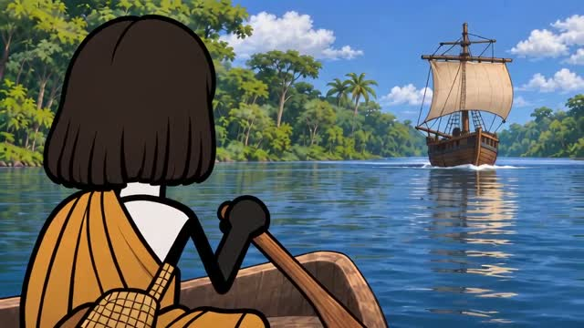

# A5 Historical Cartoon

Period costumes, painterly environments and narrated historical storytelling.

**60 seconds · Fola narration**

[Watch / download the reference video](assets/reference/preview.mp4) · [Skill instructions](SKILL.md) · [Provenance](assets/reference/manifest.json)

After installing or copying this skill, open `assets/reference/index.html` for an offline video player. The video is bundled inside this skill, so installing only this folder includes the preview.

Historical visual reference generated with the now-retired Mini model. Future production uses the current workflow; this is not a newly validated Wan result.

Invoke with `$studio-a5-history`.
