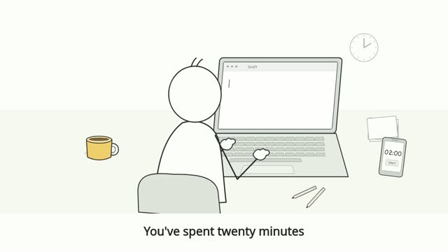

# B1 Minimal Stickman

Clean paper backgrounds, slim characters, clear desk staging and object inserts.

**30 seconds · Fola narration**

[Watch / download the reference video](assets/reference/preview.mp4) · [Skill instructions](SKILL.md) · [Provenance](assets/reference/manifest.json)

After installing or copying this skill, open `assets/reference/index.html` for an offline video player. The video is bundled inside this skill, so installing only this folder includes the preview.

Approved revised example; the portable drawing module is supplied separately.

Invoke with `$studio-b1-minimal`.
