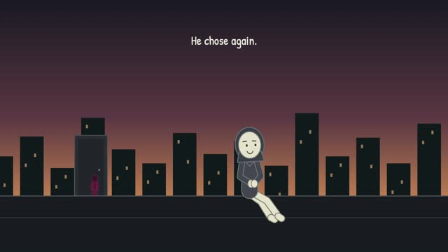

# Capsule Cinema — Articulated

Cream capsule characters, sparse dark sets, grounded body animation and clean hand contacts.

**30 seconds · Fully authored · Suno and Foley**

[Watch / download the reference video](assets/reference/preview.mp4) · [Skill instructions](SKILL.md) · [Provenance](assets/reference/manifest.json)

After installing or copying this skill, open `assets/reference/index.html` for an offline video player. The video is bundled inside this skill, so installing only this folder includes the preview.

Approved rig-refined v2, including the corrected drawer resting arm.

Invoke with `$studio-capsule-cinema`.
