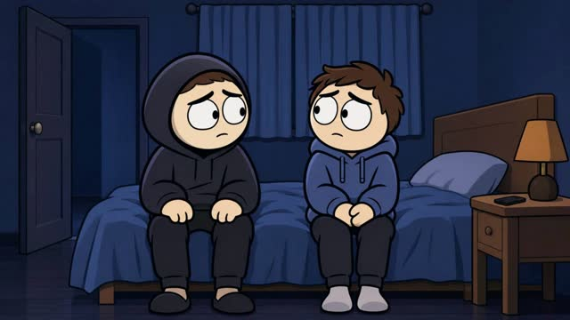

# Expressive Cartoon — Hybrid

Large eyes, bold outlines and emotional acting, with precise authored props.

**30 seconds · 70% authored / 30% Wan · Fola**

[Watch / download the reference video](assets/reference/preview.mp4) · [Skill instructions](SKILL.md) · [Provenance](assets/reference/manifest.json)

After installing or copying this skill, open `assets/reference/index.html` for an offline video player. The video is bundled inside this skill, so installing only this folder includes the preview.

The primary example is the approved 70/30 version. A separate all-Wan variant is included for comparison.

Invoke with `$studio-expressive-hybrid`.

[Watch the all-Wan variant](assets/reference/wan-only-preview.mp4).
